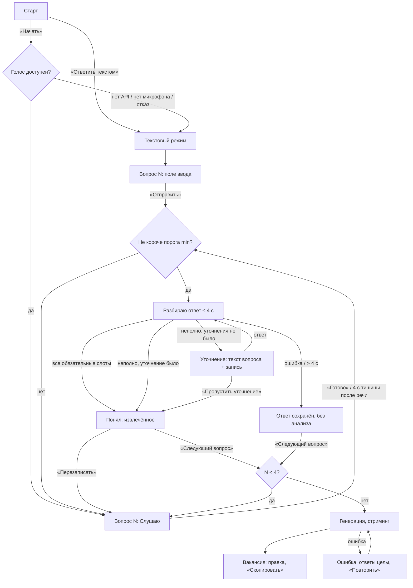

# A2. User flow и состояния

Вход: `docs/analysis.md` (A1), `docs/prompts/work-prompts.md` (А0). Выход — вход для A3 (спецификация).
Учтены пересмотры A1: полнота по слотам, «Понял» с извлечённым, `undecided` в Q3, анализ не блокирует, демо реагирует на ввод.

---

## 1. Каркас экрана (один на весь сценарий)

Никаких модалок и попапов. Любое состояние выражается четырьмя зонами:

| Зона | Назначение |
|---|---|
| **Вопрос** | Текст вопроса + пример ответа (1 строка, серым). Номер не нужен — его показывает кольцо |
| **Кольцо** | 4 сегмента = 4 вопроса. Состояние сегмента = полнота ответа. Во время записи штрихи реагируют на голос. Само кольцо — кнопка пауза/продолжить |
| **Подпись** | Одна строка статуса: «Слушаю», «Разбираю ответ», «Понял: …», ошибки и подсказки. Под ней — промежуточный текст во время записи |
| **Действия** | Не больше 2 кнопок: основная + вторичная. Плюс ссылка «Ответить текстом» / «Пропустить» |

Состояния сегмента: `пусто` · `текущий` · `заполнен` (100%) · `частично` (доля слотов) · `пропущен` (пунктир) · `без анализа` (заполнен, приглушённый).

---

## 2. Основной flow

### Цикл одного вопроса
1. Вопрос появляется → запись стартует сама (жест уже был на «Начать»/«Следующий вопрос»). Пример ответа под вопросом.
2. Пользователь говорит: штрихи кольца реагируют на громкость, промежуточный текст идёт под подписью.
3. Конец ответа: кнопка «Готово» (или Enter) либо 4 с тишины после речи. Кнопка одинаковая на всех 4 вопросах. Это кнопка, а не голосовая команда: слово «готово» встречается в обычной речи («проект готов к запуску») и обрывало бы ответ.
4. Локальная проверка (min): короче порога (Q1–Q2 — 5 слов, Q3–Q4 — 2 слова, spec §5) → не отправляем, подсказка, запись продолжается с накопленным текстом.
5. Анализ (medium): LLM извлекает слоты, код считает полноту.
6. «Понял: задачи — ревью кода, планирование спринта». Это 1–2 строки в зоне подписи под кольцом, только для текущего вопроса; блоков, карточек и вкладок нет. Ответ на прошлый вопрос открывается тапом по его сегменту (S15). Перезаписывается ответ целиком, а не отдельный пункт. Точечные опечатки распознавания правятся в тексте вакансии. Сегмент заполняется на долю слотов. Кнопки: **«Следующий вопрос»** (на Q4 — **«Собрать вакансию»**) · «Перезаписать». Отдельное предупреждение «сейчас будет следующий вопрос» не нужно: эту роль играет экран «Понял», и пользователь сам решает, когда идти дальше.
7. Если неполно и уточнения ещё не было — уточнение текстом, запись снова. Ответ на уточнение **дописывается** к исходному, анализ по объединённому тексту.

**Переход «Следующий вопрос» ручной, не автоматический.** Автопереход экономит клик, но пользователь не успевает прочитать «Понял», и ошибки распознавания уходят в вакансию — это ломает решение №2 из A1.

---

## 3. Таблица состояний

| # | Состояние | Триггер | Что видит | Что может сделать | Выход |
|---|---|---|---|---|---|
| S1 | Первый вход | Открыл ссылку, нет сохранённой сессии | Пустое кольцо, «4 вопроса о будущем сотруднике, ~3 минуты. Отвечайте голосом — микрофон нужен только для записи». Метки «Демо-режим» здесь нет: она появляется после первого ответа API (spec §4.1) | «Начать», «Ответить текстом» | → запрос микрофона / S-текст |
| S2 | Запрос микрофона | «Начать» | Системный диалог браузера; подпись «Разрешите доступ к микрофону» | Разрешить / Блокировать | Разрешил → S4; иначе → S3a |
| S3a | Микрофон запрещён | `NotAllowedError` | Текстовый режим + строка: «Микрофон заблокирован. Включить: значок слева от адреса → Микрофон → Разрешить, затем обновите страницу» | Отвечать текстом | Остаётся в тексте до перезагрузки |
| S3b | Микрофона нет | `NotFoundError` | Текстовый режим, «Микрофон не найден — отвечайте текстом» | Отвечать текстом | — |
| S3c | Браузер не поддерживает | Нет `SpeechRecognition` | Сразу текстовый режим, «Голосовой ввод работает в Chrome и Edge» | Отвечать текстом | — |
| S4 | Слушаю | Вопрос показан / «Перезаписать» / уточнение | Кольцо реагирует на голос, «Слушаю», промежуточный текст | «Готово», тап по кольцу = пауза, «Пропустить», «Ответить текстом» | → S7 или S5/S6 |
| S5 | Тишина > 5 с с начала | Ни одного слова за 5 с | Запись на паузе, кольцо статично, «Нажмите на кольцо, когда будете готовы» | Тап по кольцу, «Ответить текстом», «Пропустить» | → S4 |
| S6 | Шум / пусто | `no-speech`, или громкость есть, а текста нет 5 с | «Не разобрал речь. Говорите ближе к микрофону или ответьте текстом». После 2 раз подряд «Ответить текстом» становится основной кнопкой | Повторить, текст | → S4 / текст |
| S7 | Слишком короткий ответ | Короче порога после «Готово»: Q1–Q2 < 5 слов, Q3–Q4 < 2 слов | «Расскажите чуть подробнее», текст сохранён, запись продолжается | Договорить, «Пропустить» | → S4 (дописывает) |
| S8 | Отмена посреди записи | Тап по кольцу / Esc | Пауза, текст сохранён, «Пауза» | Продолжить (тап), «Перезаписать» (сброс текста), «Готово» | → S4 / S9 |
| S9 | Анализ идёт | Ответ отправлен | Кольцо: вращение сегмента, «Разбираю ответ» | Ничего (≤ 4 с) | → S10 / S11 / S12 / S13 |
| S10 | Понял (полно) | Все обязательные слоты | Сегмент 100%, «Понял: …» (1–2 строки извлечённого) | «Следующий вопрос», «Перезаписать» | → след. вопрос / S4 |
| S11 | Неполный → уточнение | Слоты неполны, уточнения не было; или `off_topic` | Сегмент частично, «Понял: …» + уточняющий вопрос, запись стартует. Ссылки «Пропустить» (вопрос) нет — только «Пропустить уточнение» | Ответить, «Пропустить уточнение» | → S9 (объединённый текст) / S10′ |
| S10′ | Принято частично | Неполно после уточнения или пропуск уточнения | Сегмент частично, «Понял: …» | «Следующий вопрос», «Перезаписать» | → след. вопрос |
| S12 | Анализ упал / > 4 с | Ошибка API, невалидный JSON после 1 повтора, таймаут | Сегмент «без анализа», «Ответ сохранён» + начало транскрипта | «Следующий вопрос», «Перезаписать» | → след. вопрос. Извлечение сделает генерация |
| S13 | Повтор ответа | «Перезаписать» | Сегмент обнуляется, текст и счётчик уточнения сброшены | Говорить | → S4 |
| S14 | Пропуск вопроса | «Пропустить» | Сегмент пунктиром, переход дальше | — | → след. вопрос. Раздел в вакансии не выводится |
| S15 | Возврат к вопросу | Тап по сегменту другого вопроса, только из S10/S10′/S12/S14/S20 (до генерации) | Вопрос N, «Понял: …» прежнего ответа | «Перезаписать», «Следующий вопрос» | → S4 / вперёд к текущему |
| S16 | Генерация | «Собрать вакансию» на Q4 | Кольцо замыкается (успех как Face ID), текст вакансии появляется потоком | Ждать | → S19 |
| S17 | Генерация долгая | Нет первого токена > 10 с | «Ещё немного…» | Ждать | Таймаут 30 с → S18 |
| S18 | Генерация упала | Ошибка / таймаут | «Не получилось собрать вакансию. Ответы сохранены» | «Повторить» | → S16 |
| S18′ | Частичный результат | Поток оборвался | Готовая часть текста + «Текст не дописан» | «Дописать заново» (полная перегенерация), править то, что есть | → S16 / S19 |
| S19 | Вакансия | Генерация завершена | Редактируемый Markdown-текст. Роль помечена «предположение» | Править, «Скопировать», «Новая вакансия» | Копирование → «Скопировано» на 2 с |
| S20 | Все вопросы пропущены | 4 пропуска | «Нужен хотя бы один ответ, чтобы собрать вакансию» | Тап по сегменту → вопрос | → S15 |
| S21 | Оффлайн | `offline` / ошибка `network` у распознавания | Строка «Нет сети. Ответы сохраняются, разберу их, когда сеть вернётся». Голос недоступен (Chrome распознаёт на сервере) → текстовый режим | Отвечать текстом; ответы в очереди как S12 | `online` → анализ очереди без уточнений (неполный → S10′), голос снова доступен. Генерация ждёт сеть |
| S22 | Вкладка скрыта во время записи | `visibilitychange: hidden` | По возврату: пауза (S8), «Запись приостановлена» | Продолжить, «Готово» | → S4 / S9 |
| S23 | Перезагрузка | Есть сессия в localStorage (< 7 дней) | Кольцо с заполненными сегментами, «Продолжим с вопроса N». Если вакансия уже собрана — S23 не показывается, сразу S19 с сохранённым текстом | «Продолжить» (это жест для микрофона), «Начать заново» | → S4 / S1 |
| S24 | Нет громкости для кольца | Нет `AnalyserNode` или конфликт захвата (Android) | Штрихи пульсируют при каждом новом фрагменте распознавания, а не по громкости | Как S4 | — |

### Текстовый режим
Тот же экран: вместо записи — поле ввода под вопросом, «Отправить» (Ctrl+Enter). Анализ, уточнение, сегменты — без изменений. Переход «голос ↔ текст» сохраняет уже сказанное в поле. Вернуться к голосу — ссылка «Ответить голосом», если голос доступен.

---

## 4. Таймеры и пороги

| Параметр | Значение | Почему |
|---|---|---|
| Тишина после речи → конец ответа | 4 с | 3 с из A1 обрывает людей, которые думают вслух. Подобрать на тесте |
| Тишина с начала → пауза | 5 с | Не держать открытый микрофон, пока человек не готов |
| Минимум слов | Q1–Q2 — 5, Q3–Q4 — 2 | Порог уровня min; перечень инструментов короткий по природе (spec §5) |
| Таймаут анализа | 4 с, 1 повтор при невалидном JSON внутри этого окна | Анализ не должен блокировать |
| Уточнений на вопрос | 1 | Решение из исходного контекста (А0) |
| Первый токен генерации | 10 с → подсказка, 30 с → ошибка | |
| Хранение сессии | 7 дней | |

---

## 5. Что сохраняется в localStorage

Сохраняется после каждого перехода: текущий вопрос; по каждому вопросу — транскрипт, слоты, статус сегмента, использовано ли уточнение; текстовый/голосовой режим; текст вакансии и правки (debounce 500 мс).
Не сохраняется: незавершённый промежуточный текст текущей записи (теряется не больше одной фразы), разрешение микрофона (это делает браузер).

---

## 6. Что зафиксировать в A3

1. **Оффлайн убивает голос.** Web Speech в Chrome распознаёт на серверах Google — без сети голоса нет. Это ещё один аргумент за серверный STT в «что дальше».
2. **Ответ на уточнение дописывается**, а не заменяет исходный. Иначе извлечённое из первого ответа теряется.
3. **Перезапись сбрасывает счётчик уточнения.** Новый ответ — новая попытка.
4. **Возврат к ответам после генерации вырезан.** На экране вакансии правят текст. Перегенерация после правки ответов затрёт ручные правки — сложный конфликт без ценности для прототипа.
5. **Автопереход между вопросами вырезан** (см. раздел 2).
6. **Голосовые команды вырезаны** («готово», «следующий вопрос»). Они дают ложные срабатывания на обычной речи, а кнопка и автостоп по тишине закрывают ту же задачу.
7. **Озвучка уточнения вырезана** (A1, допущение 8): «голосовой» значит, что отвечают голосом.
